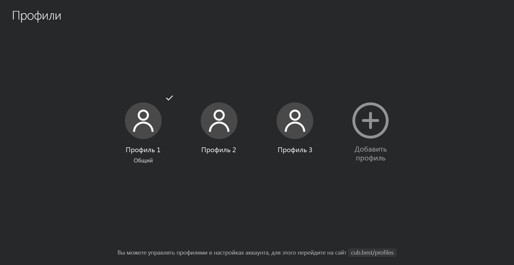
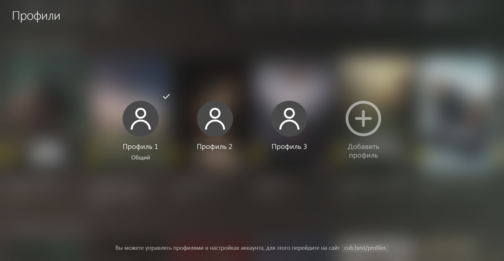

# Кто смотрит? — выбор профиля при запуске Lampa

Плагин для [Lampa](https://github.com/yumata/lampa): при каждом запуске приложения показывает выбор профиля
CUB горизонтальным рядом плиток. Родные стили, родной фокус, родное добавление профиля и PIN родительского
контроля; от плагина — только раскладка и момент показа.

## Установка

«Расширения» → «Добавить плагин» → вставить адрес:

```
https://karpov93.github.io/lampa-who-watching/who-watching.js
```

После добавления перезагрузить Lampa. Плагин подтягивается при каждом запуске, поэтому обновляется сам.

## Приватность

- **Ничего не собирает.** Ни аналитики, ни счётчиков, ни идентификаторов, ни логов.
- **Ничего не хранит.** Не пишет в настройки Lampa и не создаёт своих ключей: какой профиль был последним, помнит
  сама Lampa.
- **Своих запросов нет.** Единственное обращение к сети — `profiles/all` через API самой Lampa, чтобы узнать число
  профилей; ровно этот же запрос Lampa делает сама, когда вы открываете выбор профиля.
- **Данные аккаунта и токен никуда не передаются.** Плагин лишь просит Lampa показать её родной экран выбора.
- **Всё видно.** Один файл, около 550 строк, без сборки, минификации и зависимостей — можно прочитать целиком.

Оговорка для честности: как и любой плагин Lampa, этот код выполняется внутри страницы приложения и технически
видит то же, что видит сама Lampa. Поэтому проверять его стоит по коду — он открыт и лежит в этом репозитории.

## Что делает

- **Спрашивает профиль при каждом запуске.** Не «раз в сутки» и не «запомнить»: включили телевизор — выбрали,
  кто смотрит.
- **Горизонтальный ряд вместо списка.** Панель Lampa на весь экран, профили в естественном порядке, «Добавить
  профиль» — последней плиткой. Всё остальное — родное: иконки, подписи «основной» / «детский (до 12)», галочка
  выбранного, фон, шрифт, фокус.
- **Помнит, кто смотрел последним.** Это делает сама Lampa: её сохранённый профиль загружается до выбора, у него
  стоит галочка. Если выбран он же — панель просто закрывается, ничего не пересобирается. Если выбран другой —
  пересобирается только главная, приложение не перезапускается.
- **Ничего не переделывает.** Профили, открытые из шапки или настроек, остаются обычным вертикальным списком;
  другие селекты приложения плагин не трогает вообще.
- **«Назад» = выход.** Нажатие «назад» на экране выбора отдаётся самой Lampa: на телевизоре появляется родное
  окно «Выход». Отмена в нём возвращает к выбору профиля — остаться под прошлым профилем нельзя.

## Требования

- Lampa **3.4.8** или новее (внутренний `app_digital >= 348`); на более старых версиях плагин молча ничего не делает.
- Аккаунт **CUB** и **два и более профиля** в нём. С одним профилем спрашивать нечего — плагин не показывается.
- Профили — это профили аккаунта CUB, те же, что видны в настройках Lampa. Без аккаунта выбора нет.

## Как это выглядит

Обычный экран Lampa, только панель на весь экран и плитки в ряд: аватар, имя, подпись, галочка у выбранного.
Если профилей больше, чем влезает в ряд, появляется горизонтальная прокрутка с подтягиванием фокуса и мягкими
масками по краям.



С включённой стеклянной темой:



## Ограничения

- Только CUB-профили и только залогиненный аккаунт.
- PIN родительского контроля спрашивается как в родном приложении, то есть при каждом запуске, если он включён
  на «смену профиля».
- «Добавить профиль» остаётся родным; после создания список не перерисовывается — профиль появится при следующем
  открытии (родная особенность Lampa).
- Плагин работает с DOM селектбокса Lampa, а это не публичный API: после обновлений Lampa он может перестать
  перекрашивать панель и откатиться к родному вертикальному списку. Приложение при этом не ломается. Проверено на
  3.4.8.
- Плагина нет в магазине: установка — ссылкой, код открыт.
- Сеть: плагин сам запросов не делает, кроме проверки числа профилей перед показом (`profiles/all`, тот же запрос
  потом делает сама Lampa). Если хостинг файла недоступен, Lampa берёт последнюю удачную копию из своего кэша; при
  первой установке без сети плагина просто не будет.

## Отключение

«Расширения» → удалить плагин (долгое нажатие OK или двойное нажатие, как подсказывает сама Lampa) → перезагрузка.

## Разработка

Плагин — один файл `who-watching.js`, без зависимостей и сборки. Тесты — в `test/`, стенд вёрстки — в `dev/`.

Стенд `dev/preview.html` не требует аккаунта: показывает панель с 2/3/6/8 профилями, тёмной и светлой
темой, стрелки двигают фокус как в Lampa. Ему нужны CSS, шрифты и картинки Lampa — в репозиторий они не входят,
поэтому один раз скопируйте их из любой своей копии Lampa в `dev/lampa/`:

```powershell
copy <путь к Lampa>\css   dev\lampa\css   -Recurse
copy <путь к Lampa>\fonts dev\lampa\fonts -Recurse
copy <путь к Lampa>\img   dev\lampa\img   -Recurse

python tools/serve.py 8765     # затем открыть http://127.0.0.1:8765/
```

Стенд работает только локально: на GitHub Pages ресурсов Lampa нет, там имеет смысл смотреть только
`who-watching.js`. Проверка на живом приложении: добавьте в «Расширения» адрес
`http://<адрес-сервера>:8765/who-watching.js` и перезапустите Lampa.

Тесты (без зависимостей, заглушка Lampa в `vm`):

```powershell
node --check who-watching.js
node test/plugin.test.js
```

## Как это устроено

- Ждём `app ready` Lampa, проверяем аккаунт и число профилей (`Account.Api.load('profiles/all')`).
- Оборачиваем `Lampa.Select.show`. Срабатываем только для «своего» вызова (маркер ставится перед
  `Account.Profile.select`, плюс проверка иконок `/img/profiles/`), поэтому остальные селекты не затрагиваются.
  Перед чужими селектами маркеры снимаются — иначе наши стили остались бы на общем для всех списков DOM.
- В параметрах вызова: `fullsize: true`, реверс `items` (профили естественно, «+» в конце), обёртки `onFullDraw`
  (маркерный класс и прокрутка) и `onBack` (передать «назад» родному обработчику Lampa).
- Смена профиля: тот же профиль — панель просто закрывается; другой — пересобирается только главная
  (`Activity.replace`), приложение не перезапускается.
- Пока проверяются профили и стартует главная, показывается заставка в цвете Lampa: иначе главная успевает
  мелькнуть до первого кадра выбора.
- Всё в `try/catch`: любая ошибка оставляет родной вид и не мешает старту.

Подробности и решения — в [SPEC.md](SPEC.md).

## English

Lampa plugin that shows the CUB profile picker on every app launch, laid out as a horizontal row of tiles
while keeping Lampa's native look. Requires Lampa 3.4.8+, a CUB account and at least two
profiles. Install as any Lampa plugin: Settings → Extensions → add plugin URL. The plugin collects nothing and makes
no network requests of its own. MIT.

## Лицензия

MIT. Lampa распространяется под GPL-2.0; плагин — отдельная работа, которая общается с приложением через его
публичный API.
